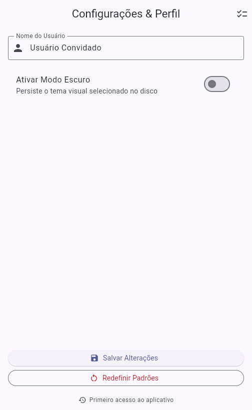
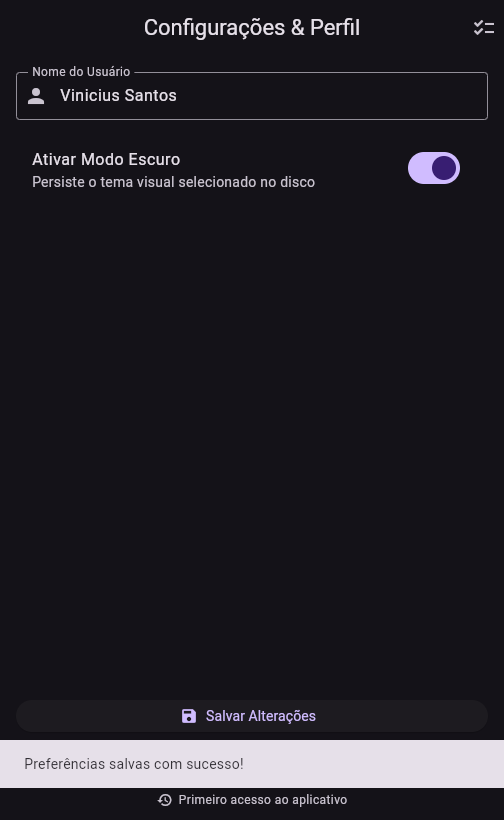
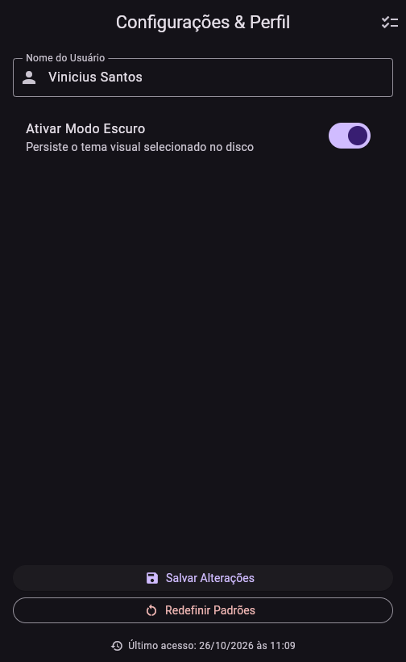
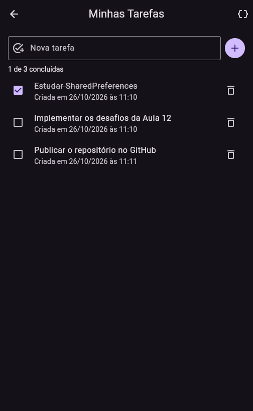
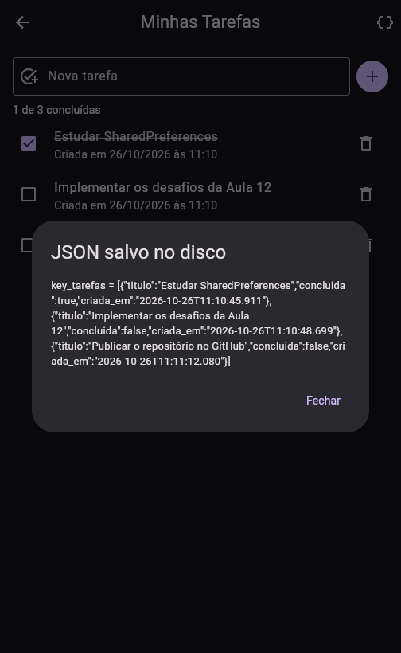
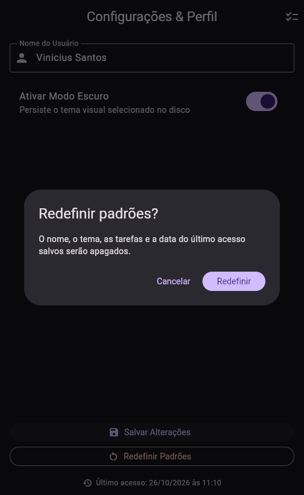
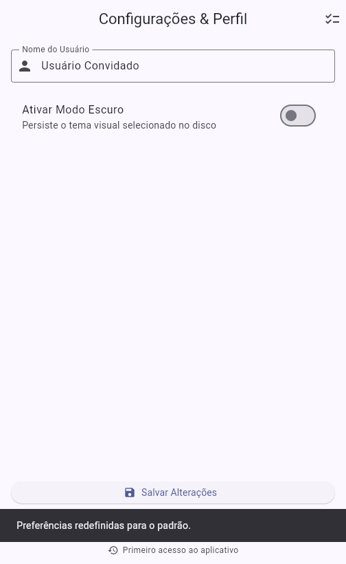
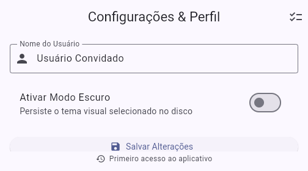
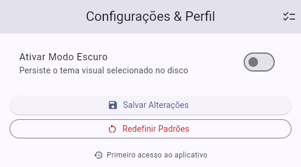

# PDM Aula 12 — Persistência Local com SharedPreferences

Roteiro prático da disciplina **Programação para Dispositivos Móveis I** (Semestre 2026/2) —
Aula 12: *Armazenamento Chave-Valor e Preferências de Usuário*.

Tela de **Configurações & Perfil** que guarda o nome do usuário e o modo escuro no armazenamento do
dispositivo com o pacote oficial [`shared_preferences`](https://pub.dev/packages/shared_preferences).
Ao fechar e abrir o app de novo, o tema e o nome voltam como estavam. Todo o acesso ao disco passa por
um único serviço (`PreferencesService`), e a interface só conversa com ele.

## Arquitetura

| Diretório / Arquivo | Responsabilidade | Conceitos aplicados |
|---|---|---|
| `lib/services/preferences_service.dart` | Único ponto de acesso ao `SharedPreferences`, com as chaves isoladas em constantes privadas | `SharedPreferences.getInstance()`, `setString`/`setBool`, `getString`/`getBool` com valor padrão (`??`), `clear()`, `jsonEncode`/`jsonDecode` |
| `lib/screens/configuracoes_screen.dart` | Nome, modo escuro, salvar, redefinir e rodapé com o último acesso | Carga no `initState`, loading com `_carregando`, `SwitchListTile`, `SnackBar`, `AlertDialog`, callback `onTemaAlterado` |
| `lib/screens/tarefas_screen.dart` | Lista de tarefas persistida como JSON | `CheckboxListTile`, `ListView.builder`, regravação da lista a cada alteração |
| `lib/models/tarefa.dart` | `Tarefa` com conversão para `Map` e de volta | `factory fromJson`, `toJson`, `copyWith` |
| `lib/utils/formatar_data.dart` | Data no padrão brasileiro (`20/10/2026 às 14:30`) | `padLeft` |
| `lib/main.dart` | Lê o tema **antes** do `runApp` e alterna `ThemeMode` | `WidgetsFlutterBinding.ensureInitialized()`, `main() async`, `StatefulWidget` na raiz |

```
lib/
├── main.dart
├── models/
│   └── tarefa.dart
├── screens/
│   ├── configuracoes_screen.dart
│   └── tarefas_screen.dart
├── services/
│   └── preferences_service.dart
└── utils/
    └── formatar_data.dart
```

### Chaves gravadas no disco

| Chave | Tipo gravado | Quando é escrita | Quando é lida |
|---|---|---|---|
| `key_nome_usuario` | `String` | Ao tocar em **Salvar Alterações** | `initState` da tela (padrão `Usuário Convidado`) |
| `key_modo_escuro` | `bool` | Ao tocar em **Salvar Alterações** | No `main()`, antes do `runApp`, e no `initState` da tela |
| `key_ultimo_acesso` | `String` (`DateTime.now().toString()`) | Toda vez que o app abre | Na abertura, antes de gravar o novo valor |
| `key_tarefas` | `String` com o JSON de uma `List<Map>` | A cada tarefa adicionada, concluída ou removida | `initState` da tela de tarefas |

### Fluxo de leitura e escrita

1. `main()` chama `WidgetsFlutterBinding.ensureInitialized()` e espera `obterModoEscuro()`. O primeiro
   quadro já sai com o tema certo, sem piscar no tema claro.
2. `ConfiguracoesScreen` mostra um `CircularProgressIndicator` enquanto o `initState` lê o nome, o tema
   e o último acesso. Depois preenche o `TextEditingController` e o switch.
3. **Salvar Alterações** grava com `setString`/`setBool` e chama `onTemaAlterado`. O `setState` do
   `MeuApp` troca o `themeMode` na hora.

## Desafios de laboratório implementados

O roteiro pede um nível. Os três foram resolvidos:

| Nível | Desafio | Implementação |
|---|---|---|
| **Básico** | Data do Último Acesso | `registrarAcesso()` lê `key_ultimo_acesso`, grava `DateTime.now().toString()` com `setString` e devolve o valor **anterior**. Assim o rodapé mostra a execução passada ("Último acesso: 26/10/2026 às 11:09"). No primeiro uso aparece "Primeiro acesso ao aplicativo" |
| **Intermediário** | Resetar Preferências | Botão **Redefinir Padrões** com diálogo de confirmação. Ao confirmar, chama `service.limparTudo()` e recarrega a tela pelo mesmo caminho do `initState`. Com o disco vazio, o serviço devolve os padrões (`Usuário Convidado`, tema claro), e `onTemaAlterado(false)` volta o app para o tema claro na hora |
| **Avançado** | Armazenamento de Lista JSON em String | Tela **Minhas Tarefas** (ícone na `AppBar`). Cada `Tarefa` vira um `Map` (`toJson`), a lista inteira vira **uma** `String` com `jsonEncode` e vai para `setString`. Na leitura, `jsonDecode` + `Tarefa.fromJson` reconstroem a lista. Dá para adicionar (botão ou Enter), concluir, remover e ver o JSON gravado pelo botão `{ }`. Uma `String` corrompida no disco vira lista vazia em vez de travar o app |

## Evidências

Capturas do app rodando no navegador (Flutter Web). Na web, o `shared_preferences` grava no
`localStorage` com o prefixo `flutter.`. Depois de salvar, o armazenamento ficou assim:

```json
{
  "flutter.key_ultimo_acesso": "\"2026-10-26 11:09:31.712\"",
  "flutter.key_nome_usuario": "\"Vinicius Santos\"",
  "flutter.key_modo_escuro": "true"
}
```

| Primeiro acesso | Preferências salvas | Básico — app reaberto |
|---|---|---|
|  |  |  |
| Disco vazio: valores padrão e "Primeiro acesso" no rodapé | `setString`/`setBool`, tema escuro aplicado na hora e `SnackBar` | Página recarregada: nome e tema restaurados, rodapé com o acesso anterior |

| Avançado — tarefas | Avançado — JSON gravado |
|---|---|
|  |  |
| Lista lida do disco com `jsonDecode` após recarregar a página, com a conclusão mantida | A `List<Map>` guardada como uma única `String` na chave `key_tarefas` |

| Intermediário — confirmação | Intermediário — padrões restaurados |
|---|---|
|  |  |
| Aviso do que será apagado antes do `limparTudo()` | Nome padrão, tema claro e "Primeiro acesso" de novo |

**Correção de layout** — tela com 280 px de altura (como com o teclado aberto): o conteúdo rola até
os botões, sem a faixa amarela e preta de overflow.

| Topo | Rolada até o fim |
|---|---|
|  |  |

## Como executar

```bash
flutter pub get
flutter run -d chrome    # ou: flutter run -d windows
```

> Para rodar no Windows, o Flutter exige o **Modo de Desenvolvedor** ativo (os plugins usam links
> simbólicos). No navegador não é preciso.

## Testes

São 22 testes. O disco é simulado com `SharedPreferences.setMockInitialValues`, que troca o
armazenamento nativo por um mapa em memória. Assim cada teste começa com um estado conhecido e confere
o valor exato gravado em cada chave: o tipo (`String`/`bool`), o formato do `DateTime.toString()` e o
JSON da lista de tarefas.

| Grupo | O que é verificado |
|---|---|
| `PreferencesService` | Valores padrão, chaves do roteiro, `limparTudo`, `registrarAcesso`, ida e volta do JSON e JSON corrompido |
| Tela do roteiro | Loading antes da leitura, preenchimento pelo `initState`, tema escuro desde o `main()`, salvar com troca imediata do tema |
| Desafio Básico | "Primeiro acesso", data anterior formatada no rodapé e gravação do acesso atual |
| Desafio Intermediário | Cancelar mantém tudo; confirmar limpa o disco e restaura nome, switch e tema |
| Desafio Avançado | Lista vazia, adicionar/concluir/remover regravando o JSON, título em branco, reabertura da tela e diálogo do JSON |
| Correção | Tela com 400 px rola sem overflow (o teste falha no layout do roteiro), e com 800 px os botões ficam no fim da tela |

```bash
flutter test
```

```
00:04 +22: All tests passed!
```

## Ajustes em relação ao código do roteiro

- **Overflow com o teclado aberto:** o roteiro usa `Spacer` dentro de uma `Column` fixa. Com 300 px de
  altura o layout original já estourava 52 px; com os botões dos desafios, estourava 56 px a 400 px,
  altura comum num celular com o teclado aberto. A coluna agora fica num `SingleChildScrollView` com
  altura mínima igual à da tela (`LayoutBuilder` + `ConstrainedBox`) e `spaceBetween` no lugar do
  `Spacer`. Quando sobra espaço, os botões continuam no fim da tela; quando falta, a tela rola. O
  `SliverFillRemaining` foi testado antes, mas ele mede a altura intrínseca dos campos do Material, que
  sai 20 px menor que a real, e o overflow continuava.
- **Ciclo de vida:** a tela do roteiro não liberava o `TextEditingController` no `dispose` e chamava
  `setState` depois do `await` sem conferir `mounted`. Os dois foram corrigidos.
- **Último acesso:** gravar a data e exibi-la logo em seguida mostraria sempre o horário atual. O
  serviço lê o valor anterior antes de sobrescrever, então o rodapé mostra a execução passada.
- **`limparTudo()` usa `clear()`:** apaga **todas** as chaves do app, inclusive as tarefas e o último
  acesso. O diálogo avisa isso antes. Depois da limpeza, este acesso é registrado de novo, como em um
  app recém-instalado.
- **Versão do pacote:** o roteiro indica `^2.2.2`; o `flutter pub add` gravou `^2.5.6`, versão atual
  dentro da mesma faixa. O `pubspec.yaml` entrou no commit do serviço porque o serviço já importa o
  pacote. Assim cada commit compila sozinho.

## Histórico de commits

O versionamento segue o padrão de **commits semânticos** (Conventional Commits). Os dois primeiros
`feat:` usam as mensagens dadas no roteiro:

```
chore: inicializa projeto Flutter pdm_aula12_shared_preferences
feat: cria PreferencesService para isolamento do SharedPreferences
feat: implementa tela de configuracoes com persistencia de tema e perfil
feat: registra a data do ultimo acesso e exibe no rodape (Desafio Basico)
feat: adiciona botao Redefinir Padroes que limpa o disco e restaura a interface (Desafio Intermediario)
feat: persiste lista de tarefas como String JSON com jsonEncode e jsonDecode (Desafio Avancado)
fix: evita overflow da tela de configuracoes com o teclado aberto e libera o controller
test: cobre o PreferencesService, a tela do roteiro, os tres desafios e o layout com teclado aberto
docs: adiciona README com arquitetura e evidencias de execucao
```
